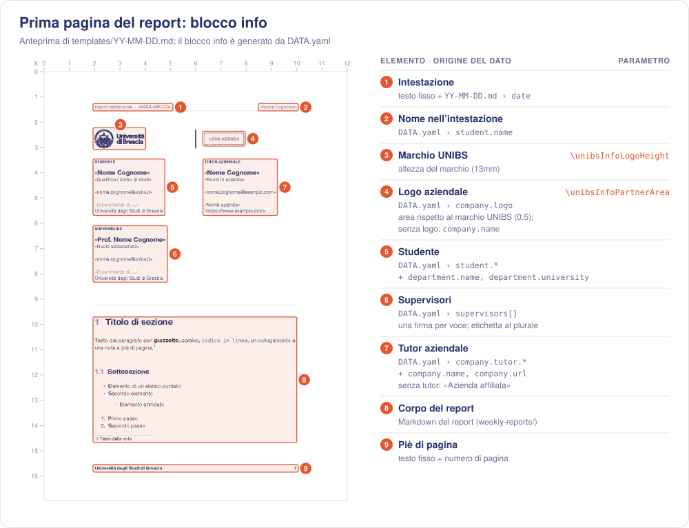
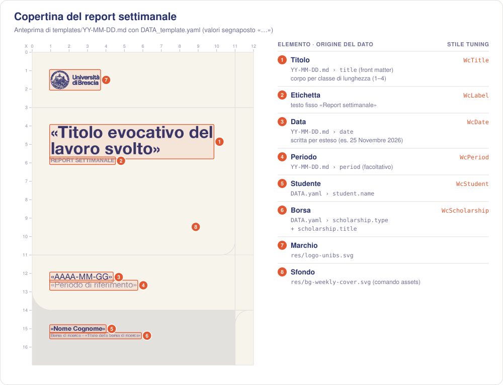
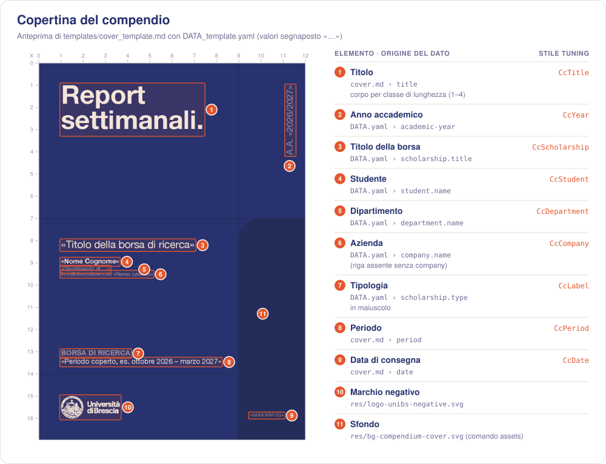

# UNIBS_REPORT

## NAME

**unibs-report** — generazione in PDF dei weekly-report della borsa di ricerca
(Università degli Studi di Brescia), secondo la visual identity UNIBS.

## SYNOPSIS

```
pandoc lua scripts/unibs.lua report [FILE.md ...]
pandoc lua scripts/unibs.lua compendium
pandoc lua scripts/unibs.lua all
pandoc lua scripts/unibs.lua new [YY-MM-DD]
pandoc lua scripts/unibs.lua cover
pandoc lua scripts/unibs.lua assets
pandoc lua scripts/unibs.lua help
```

Equivalenti con il solo Pandoc (dalla radice del progetto):

```
pandoc weekly-reports/YY-MM-DD.md --defaults=pandoc-defaults-report.yaml -o weekly_reports_pdf/YY-MM-DD.pdf
pandoc --defaults=pandoc-defaults-compendium.yaml
```

## DESCRIPTION

Separa la **scrittura** dal **rendering**:

- lo studente compila `DATA.yaml` e `cover.md` e scrive i report in Markdown
  (`weekly-reports/*.md`), partendo dai modelli in `templates/`;
- la suite (defaults Pandoc, filtri Lua, preamboli LaTeX, sfondi SVG) produce i PDF.

Ogni **report** è un PDF *copertina settimanale + blocco info personali + corpo*.
Il **compendio** è *copertina del compendio + blocco info + indice + premessa
(facoltativa) + tutti i report in ordine cronologico, ciascuno con la propria
copertina settimanale*. Tutti i PDF finiscono in `weekly_reports_pdf/`.

I dati ripetuti (studente, borsa, supervisori, dipartimento, azienda e tutor,
anno accademico) stanno **solo** in `DATA.yaml`: copertine e blocco info li
leggono da lì, i report non li ripetono mai.

Il **blocco info personali** ha due colonne, ciascuna aperta dal proprio
marchio: a sinistra il marchio UNIBS con studente e supervisori, a destra il
marchio dell'azienda affiliata con il tutor aziendale. Ogni persona è resa come
una firma istituzionale: nome e ruolo, contatti, dipartimento (in tono
attenuato) ed ente di appartenenza (ateneo o azienda).

## PREREQUISITES

| Componente | Versione | Note |
|---|---|---|
| Pandoc | ≥ 3.1 | deve essere nel `PATH` (`pandoc --version`). Fornisce anche l'interprete Lua usato dagli script. |
| Distribuzione LaTeX con **LuaLaTeX** | TeX Live / MacTeX ≥ 2023, oppure MiKTeX aggiornato | pacchetti usati: `koma-script`, `fontspec`, `unicode-math`, `babel-italian`, `tcolorbox`, `pgf` (TikZ), `eso-pic`, `enumitem`, `caption`, `ragged2e`, `booktabs`, `colortbl`, `longtable`, `etoolbox`, `hyperref`, `tex-gyre`. Con MiKTeX abilitare *Install missing packages on-the-fly*. |
| Font | Helvetica Neue (preinstallato su macOS) | **Antarctica** (font istituzionale, a pagamento) viene usato automaticamente se installato nel sistema. In mancanza di entrambi (es. Windows): TeX Gyre Heros, clone di Helvetica incluso nella distribuzione LaTeX. |
| VS Code + `chrischinchilla.vscode-pandoc` | facoltativi | task e impostazioni in `.vscode/`. |
| `rsvg-convert` (librsvg) | facoltativo | per il comando `assets` (dopo aver modificato un SVG in `res/`) e per un logo aziendale SVG di cui non esiste ancora il PDF. |

Installazione rapida:

- **macOS**: `brew install pandoc librsvg` e MacTeX (`brew install --cask mactex-no-gui`).
- **Windows**: installer di Pandoc da pandoc.org e MiKTeX (o TeX Live) da miktex.org;
  riaprire VS Code dopo l'installazione perché il nuovo `PATH` sia visto.
  `rsvg-convert` è disponibile, ad esempio, con `choco install rsvg-convert`.

## USAGE

### 0. Preparare il progetto (una volta)

Clonare il repository (`git clone <url>`) e aprire la cartella in VS Code.
Il repository contiene solo la suite e i modelli: i file con i dati di ogni
studente (`DATA.yaml`, `cover.md`, report, immagini, PDF, logo aziendale) sono
esclusi da git tramite `.gitignore` e restano solo in locale.

La cartella `templates/` contiene i modelli, con valori segnaposto `«…»`; non
si compilano lì:

| Modello | Diventa | Come |
|---|---|---|
| `templates/DATA_template.yaml` | `DATA.yaml` | copia manuale nella radice del progetto |
| `templates/cover_template.md` | `cover.md` | task **UNIBS: nuova copertina compendio** o comando `cover` |
| `templates/YY-MM-DD.md` | `weekly-reports/YY-MM-DD.md` | task **UNIBS: nuovo report** o comando `new` |

`cover` e `new` non sovrascrivono mai un file esistente: se la destinazione
c'è già, si fermano con un errore. Se mancano `DATA.yaml` o `cover.md`, i comandi
di rendering lo segnalano indicando come crearli.

### 1. Compilare `DATA.yaml`

Sostituire ogni valore `«…»` (simboli « » compresi) con il dato reale,
mantenendo le virgolette e i nomi delle chiavi:

| Chiave | Contenuto | Dove compare |
|---|---|---|
| `academic-year` | es. `"2026/2027"` | copertina compendio (verticale) |
| `scholarship.type` | tipologia, default `"Borsa di ricerca"` | copertine |
| `scholarship.title` | titolo della borsa | copertine |
| `student.name` / `role` / `email` | studente (email facoltativa) | copertine, blocco info, intestazione pagine |
| `supervisors` | lista di `name` + `role` (+ `email` facoltativa); più voci = più supervisori | blocco info |
| `department.name` / `university` | dipartimento di studente e supervisori, ateneo | blocco info (in ogni firma), copertina compendio |
| `…department` in una persona | dipartimento della singola persona, se diverso da `department.name`; per il tutor, reparto aziendale | blocco info |
| `company.name` / `url` | azienda affiliata (`url` facoltativo) | blocco info, copertina compendio |
| `company.logo` | percorso del logo aziendale, relativo alla cartella di `DATA.yaml` (es. `res/logo-azienda.svg`); SVG, PDF, PNG o JPG; facoltativo | blocco info |
| `company.tutor.name` / `role` / `email` | tutor aziendale (tutto il blocco e l'email facoltativi) | blocco info |

Una riga facoltativa si elimina del tutto. Finché resta un placeholder `«…»`,
ogni rendering lo segnala nel terminale elencando i campi (`[unibs] … campi
ancora da compilare`), ma il PDF viene comunque prodotto.

La prima pagina di ogni report si apre con il blocco info, interamente
generato da `DATA.yaml`. La figura mostra, sul modello renderizzato, da quale
chiave arriva ogni parte:



Blocco info, casi particolari:

- senza `company.logo`, al posto del marchio compare il nome dell'azienda;
- senza `company.tutor`, la colonna destra mostra l'azienda (nome e sito);
- senza `company`, il blocco ha la sola colonna UNIBS;
- un logo SVG viene incluso tramite il PDF omonimo accanto a esso, creato al
  primo rendering con `rsvg-convert`. Se l'SVG cambia, rigenerare il PDF con
  il comando `assets`.

### 2. Scrivere un report (ogni settimana)

1. Creare `weekly-reports/YY-MM-DD.md` (es. `26-11-20.md`) con il task
   **UNIBS: nuovo report** o con `pandoc lua scripts/unibs.lua new 26-11-20`
   (senza data: oggi). Il file nasce da `templates/YY-MM-DD.md` con `date` già
   compilata.
2. Compilare il front matter:

   ```yaml
   title: "Titolo evocativo del lavoro svolto"
   date: "2026-11-20"           # data di invio (AAAA-MM-GG), resa come "20 novembre 2026"
   period: "16–20 novembre 2026" # facoltativo, testo libero
   ```

   `date` accetta anche testo libero (reso così com'è); se manca, si usa la data
   del nome del file. Front matter e `DATA.yaml` compongono la copertina del
   report (i nomi `Wc…` sono le righe di stile, vedi *Regolare le copertine*):

   
3. Scrivere il corpo in Markdown, con struttura libera. Disponibili: titoli `#`,
   `##`, `###` (numerati), elenchi, tabelle con didascalia (`: Didascalia`),
   figure con didascalia (`{width=70%}`), citazioni,
   blocchi di codice, note, link. Le immagini si mettono in `weekly-reports/img/`
   e si referenziano come `img/…`.

Il nome `YY-MM-DD.md` è la chiave di ordinamento del compendio: in
`weekly-reports/` i file con nome diverso sono esclusi dal compendio, ma restano
renderizzabili singolarmente.

### 3. Compendio

Compilare `cover.md`: `title`, `period` (facoltativo), `date` (data di
consegna, facoltativa). Il corpo è facoltativo e diventa una premessa dopo
l'indice. Poi lanciare il comando `compendium`. Gli altri dati della copertina
arrivano da `DATA.yaml` (i nomi `Cc…` sono le righe di stile, vedi *Regolare le
copertine*):



### 4. Lanciare il rendering

**VS Code — task** (*Terminal ▸ Run Task…*):

| Task | Effetto |
|---|---|
| `UNIBS: PDF del report corrente` | report del file `.md` aperto (task di build predefinito: `Cmd/Ctrl+Shift+B`) |
| `UNIBS: PDF del compendio` | `weekly_reports_pdf/compendio.pdf` |
| `UNIBS: tutti i PDF` | ogni report `YY-MM-DD.md` + compendio |
| `UNIBS: nuovo report` | chiede la data (vuoto = oggi) e crea il report dal modello |
| `UNIBS: nuova copertina compendio` | crea `cover.md` dal modello; si ferma se esiste già |
| `UNIBS: rigenera asset grafici (SVG → PDF)` | converte `res/*.svg` (sfondi delle copertine, marchi, logo aziendale) nei PDF usati da LaTeX |

**VS Code — plugin Pandoc**: con un report di `weekly-reports/` aperto, comando
*Pandoc Render* (formato `pdf` preimpostato). Le impostazioni in
`.vscode/settings.json` passano `--defaults=../pandoc-defaults-report.yaml` e
scrivono in `../weekly_reports_pdf/`. Il PDF non viene aperto automaticamente
(vedi LIMITATIONS). Il compendio si genera solo con task o script.

**Terminale** (Windows e macOS, stessa sintassi):

| Comando | Effetto |
|---|---|
| `report [FILE.md ...]` | PDF dei report indicati; senza argomenti, il più recente |
| `compendium` | PDF del compendio |
| `all` | tutti i report + compendio |
| `new [YY-MM-DD]` | nuovo report da `templates/YY-MM-DD.md` (default: oggi) |
| `cover` | `cover.md` da `templates/cover_template.md`; errore se esiste già |
| `assets` | rigenera `res/*.pdf` da `res/*.svg` (richiede `rsvg-convert`) |

Lo script funziona da qualunque cartella e usa sempre la radice del progetto.
Per un Pandoc fuori dal `PATH`: variabile d'ambiente `PANDOC=/percorso/pandoc`.

### Risoluzione dei percorsi

Pandoc risolve i percorsi relativi **rispetto alla cartella da cui viene
eseguito** (working directory), non rispetto al file Markdown. Pertanto:

- nei defaults, filtri, preamboli, `DATA.yaml`, input e output del compendio
  sono scritti come `${.}/…`, cioè relativi alla cartella del file defaults:
  funzionano da qualunque working directory;
- input e `-o` passati a riga di comando sono relativi alla working directory
  (lo script e i task lavorano dalla radice; il plugin dalla cartella del file,
  per questo le sue opzioni usano `../`);
- le immagini sono cercate nella working directory, in `weekly-reports/` e in
  `templates/` (`resource-path`), quindi `img/…` funziona in tutti i casi;
- `company.logo` è risolto dai filtri rispetto alla radice del progetto;
- `--defaults=…` stesso è relativo alla working directory.

### Regolare le copertine

La tipografia delle copertine è nel blocco **TUNING** in cima a
`headers/unibs-covers.tex`: una riga `\unibsCoverStyle` per ogni elemento di
testo, con corpo, interlinea, peso e spaziatura propri.

```latex
%                element         size              leading  weight     tracking
\unibsCoverStyle{CcTitle}       {58, 47, 38, 31}  {0.98}  {bold}     {0}
\unibsCoverStyle{CcYear}        {20}              {0.98}  {regular}  {0}
```

I nomi degli elementi sono quelli delle figure in USAGE: `Cc…` per la
copertina del compendio (USAGE 3), `Wc…` per quella del report (USAGE 2). Dopo
ogni modifica si rigenera un PDF e lo si confronta con il precedente.

| Colonna | Valori | Effetto |
|---|---|---|
| `size` | pt | corpo del testo. I titoli (`CcTitle`, `WcTitle`) hanno quattro valori, uno per classe di lunghezza (vedi sotto); con meno valori si usa l'ultimo. |
| `leading` | rapporto, es. `0.98` | distanza tra le linee di base diviso il corpo: `1` = interlinea pari al corpo, valori maggiori aprono le righe. È il valore effettivo: il `linestretch` dei defaults non vale sulle copertine. Agisce tra le righe dello stesso elemento (titoli e testi che vanno a capo) e sulla distanza dall'elemento precedente nello stesso blocco. Sotto `0.85` ascendenti e discendenti di righe vicine iniziano a toccarsi. Da Figma: altezza di riga in % / 100; da Adobe: interlinea in pt / corpo. |
| `weight` | `ultralight`, `thin`, `light`, `regular`, `medium`, `bold`, `black` | peso del font. Helvetica Neue li ha tutti tranne `black`; TeX Gyre Heros solo `regular` e `bold`. Un peso non installato ricade sul più vicino disponibile (avviso `LaTeX Font Warning` nel log); un nome fuori elenco ferma il rendering con un errore. |
| `tracking` | numero, `0` = spaziatura del font | spaziatura tra le lettere in percentuale del corpo (`LetterSpace` di fontspec): positivi aprono, negativi stringono. Da Figma: letter spacing in % così com'è; da Adobe: tracking (millesimi di em) / 10. |

Colori, stacchi verticali tra gli elementi (`\vspace{…}`) e posizioni sulla
griglia (coordinate `at (x,y)` in mm, multipli di X = 17,5 mm, come i righelli
delle figure) sono nelle macro `\unibsWeeklyCover` e `\unibsCompendiumCover`
dello stesso file.

Le **classi di lunghezza** dei titoli evitano che un titolo lungo esca dalla sua
area: le soglie (in caratteri) sono in `headers/unibs-common.lua`, nelle
chiamate a `M.title_class`. Per il report sono 70 / 120 / 200, per il compendio
40 / 80 / 130; oltre l'ultima soglia si usa la classe 4.

Il **blocco info** (figura in USAGE 1) ha due parametri nello stesso file:

| Parametro | Default | Effetto |
|---|---|---|
| `\unibsInfoLogoHeight` | `13mm` | altezza del marchio UNIBS |
| `\unibsInfoPartnerArea` | `0.5` | area del logo aziendale rispetto al marchio UNIBS. Il logo partner non supera mai l'altezza del marchio UNIBS né la larghezza della colonna. |

## FILES

```
UNIBS_report/
├── DATA.yaml                         dati ripetuti (studente)
├── cover.md                          copertina del compendio (studente)
├── weekly-reports/
│   ├── 26-11-20.md …                 report settimanali (studente)
│   └── img/                          immagini dei report
├── templates/
│   ├── DATA_template.yaml            modello di DATA.yaml
│   ├── cover_template.md             modello di cover.md
│   ├── YY-MM-DD.md                   modello del report (mostra la formattazione)
│   └── img/                          immagine d'esempio del modello
├── weekly_reports_pdf/               output: YY-MM-DD.pdf, compendio.pdf
├── pandoc-defaults-report.yaml       defaults: singolo report
├── pandoc-defaults-compendium.yaml   defaults: compendio
├── headers/
│   ├── unibs-style.tex               colori, font, layout, titoli, tabelle, codice
│   ├── unibs-covers.tex              copertine e blocco info (TikZ + eso-pic), TUNING
│   ├── unibs-compendium.tex          indice del compendio
│   ├── unibs-common.lua              DATA.yaml → macro LaTeX, blocco info, date, placeholder
│   ├── report.lua                    filtro: singolo report
│   └── compendium.lua                filtro: compendio
├── res/
│   ├── bg-weekly-cover.svg/.pdf      sfondo copertina settimanale
│   ├── bg-compendium-cover.svg/.pdf  sfondo copertina compendio
│   ├── logo-unibs(-negative).svg/.pdf  marchio positivo / negativo
│   ├── logo-<azienda>.svg/.pdf       logo aziendale (da company.logo)
│   └── reference/                    materiali di riferimento (solo in locale, esclusi da git)
├── docs/                             figure del README (anteprime annotate dei modelli)
├── scripts/unibs.lua                 entry point (pandoc lua)
├── .vscode/                          tasks.json, settings.json, extensions.json
└── .gitignore                        esclude i dati dello studente (vedi USAGE 0)
```

Lo studente modifica solo `DATA.yaml`, `cover.md` e i `.md` in
`weekly-reports/`, ed eventualmente aggiunge il logo aziendale in `res/`.
Tutto il resto è della suite.

## EXAMPLES

```
pandoc lua scripts/unibs.lua cover
pandoc lua scripts/unibs.lua new 26-11-20
pandoc lua scripts/unibs.lua report weekly-reports/26-11-20.md
pandoc lua scripts/unibs.lua report
pandoc lua scripts/unibs.lua compendium
pandoc lua scripts/unibs.lua all
pandoc lua scripts/unibs.lua assets
```

Anteprima del modello di report (dalla radice):

```
pandoc templates/YY-MM-DD.md --defaults=pandoc-defaults-report.yaml -o weekly_reports_pdf/modello.pdf
```

Debug del LaTeX generato (dalla radice):

```
pandoc weekly-reports/26-11-20.md --defaults=pandoc-defaults-report.yaml -o debug.tex
```

## DESIGN NOTES

- **Motore: LuaLaTeX.** Usa i font di sistema via `fontspec` su Windows e
  macOS senza configurazione; la scelta del font è automatica:
  Antarctica → Helvetica Neue → TeX Gyre Heros. Antarctica non ha corsivo
  (brand manual): se usato, il corsivo è un tondo inclinato. Oltre a regular e
  bold, ogni peso installato della famiglia (es. `Helvetica Neue Light`) è
  registrato come serie NFSS, così le copertine possono usarlo.
- **Lettura di `DATA.yaml`**: `metadata-files` nei defaults. I filtri Lua
  convertono i dati in macro LaTeX (`\unibsStudentName`, …) inserite all'inizio
  del corpo e generano copertine e blocco info. I preamboli `.tex` sono statici
  (`include-in-header`); i dati non passano da `header-includes`, che Pandoc
  ignora quando è presente `include-in-header`.
- **Compendio**: un'unica esecuzione di Pandoc. `compendium.lua` legge ogni
  `YY-MM-DD.md` con `pandoc.read`, lo ordina per nome, antepone la copertina
  settimanale e prefissa gli identificatori (link interni e ancore restano unici
  tra report). Rispetto all'unione di PDF: indice e segnalibri navigabili,
  numerazione di pagina continua, nessuna dipendenza extra. Sezioni, figure,
  tabelle e note ripartono da 1 a ogni report, come nel PDF singolo.
- **Blocco info nel compendio**: compare una sola volta, dopo la copertina,
  invece di ripetersi identico a ogni settimana.
- **Blocco info, cobranding**: marchio UNIBS e logo aziendale seguono le
  regole di affiancamento del brand manual ("Cobranding"):
  - stesso asse orizzontale centrale;
  - rapporto equilibrato, ottenuto bilanciando le aree, così un logo molto
    largo risulta più basso e uno compatto più alto;
  - filetto verticale da 1 pt tra i marchi, con area di rispetto di almeno 2X
    per lato.
  Le firme seguono gli esempi di resa delle entità e delle informazioni
  personali del brand manual:
  - nome in grassetto 1,3 volte il corpo del testo;
  - interlinea 1,3;
  - una riga vuota tra i gruppi (ruolo, contatti, affiliazione);
  - dipartimento in Blu notte 40%;
  - etichette maiuscole senza spaziatura aggiuntiva.
- **Filetto dei titoli di primo livello**: separa il titolo da ciò che lo
  precede. Nel compendio è omesso quando il report si apre con un titolo subito
  dopo la propria copertina, dove non separerebbe nulla.
- **Entry point in Lua (`pandoc lua`)**: nessuna dipendenza oltre a Pandoc
  (niente Python, Make o shell), stessa sintassi su Windows e macOS; i task VS
  Code sono di tipo `process`, quindi indipendenti dalla shell.
- **Due defaults autonomi** (report, compendio) invece dell'ereditarietà
  `defaults:`: con file annidati Pandoc risolve `${.}` rispetto all'ultimo file
  caricato, rompendo i percorsi.
- **Griglia e grafica**: A4 diviso in 12 moduli, X = 17,5 mm. Le linee degli
  sfondi cadono su questa griglia, con raccordi arrotondati, al massimo 3 per
  copertina. Il marchio è alto 1X, con margine 1X. Il comando `assets`
  converte gli sfondi su una pagina A4 esatta: i programmi di grafica esportano
  il riquadro arrotondato a pixel interi (794 × 1123 invece di 793,7 × 1122,5),
  e la differenza lascerebbe una sottile striscia bianca sui bordi destro e
  inferiore.
  - Copertina settimanale: layout "forme e linee" su Neutro caldo.
  - Copertina del compendio: layout "monocromatico" Blu notte, con un'area
    tono-su-tono Blu scuro.
- **Corpo**:
  - testo: Helvetica Neue 10,5 pt (Antarctica se installato), bandiera
    sinistra come nella carta intestata UNIBS, colore Nero `#1D1D1B`;
  - colori: titoli in Blu notte, numeri ed etichette in Blu notte 40%, linee
    divisorie in Blu notte 10% sopra i titoli di primo livello, codice su
    Neutro caldo. Le tinte percentuali sono campionate dalla palette ufficiale;
  - margini di 2X (35 mm), per righe di lunghezza leggibile.
- **Copertine**: ogni elemento di testo ha corpo, interlinea, peso e
  spaziatura propri, in un'unica tabella (vedi *Regolare le copertine*). Il
  titolo sceglie automaticamente una classe di corpo in base alla propria
  lunghezza.

## LIMITATIONS

- **Antarctica** (scritto così nelle guidelines) non è stato provato perché non
  installato. Viene usato solo se il font è nel sistema con il nome di
  famiglia `Antarctica` (e, per il grassetto, `Antarctica Bold`; per gli altri
  pesi `Antarctica Light`, `Antarctica Medium`, …); con un nome diverso si
  ricade su Helvetica Neue. Le misure delle copertine sono tarate su
  Helvetica Neue: con Antarctica conviene un controllo visivo ed eventualmente
  un ritocco dei parametri TUNING.
- **Windows** non ha Helvetica Neue: senza Antarctica si usa TeX Gyre Heros,
  disegno equivalente a Helvetica ma con metriche leggermente diverse e i soli
  pesi regular e bold.
- **Prima esecuzione di LuaLaTeX**: costruisce la cache dei font e può
  richiedere alcuni minuti; con MiKTeX, la prima volta scarica anche i pacchetti
  mancanti. Le esecuzioni successive richiedono pochi secondi.
- **Plugin Pandoc**: lancia Pandoc dalla cartella del file, quindi le sue opzioni
  funzionano solo per i `.md` in `weekly-reports/` (o `templates/`). Risolve la
  cartella di output relativa rispetto alla working directory di VS Code per
  l'apertura automatica e per la conferma di sovrascrittura: entrambe sono
  disattivate.
- **Sfondi e loghi** sono PDF generati dagli SVG. Se si modifica un SVG serve
  `rsvg-convert` e il comando `assets`: il rendering non può accorgersi che un
  PDF esistente è più vecchio del suo SVG. L'SVG del marchio è il file fornito
  (colore `#273777`); la versione negativa è ricolorata in Neutro caldo.
- **Windows** è supportato per costruzione ma non è stato collaudato: i percorsi
  passati a LaTeX sono convertiti in `/` e quelli con spazi funzionano (verificato
  su macOS). Cartelle con caratteri non ASCII nel percorso possono creare problemi
  con alcune versioni di MiKTeX. I nomi di file in `DATA.yaml` (es.
  `company.logo`) vanno scritti con le stesse maiuscole del file su disco.
- **Riferimenti incrociati** ("vedi Tabella 2") non sono automatici: la
  numerazione è di LaTeX; per riferimenti etichettati servirebbe `pandoc-crossref`.
- **Ordine del compendio**: dato dal nome `YY-MM-DD` (anni 2000–2099).
- **Figure di `docs/`**: immagini statiche dei modelli con i valori TUNING di
  riferimento; modifiche a TUNING o alla disposizione non vi si riflettono.
