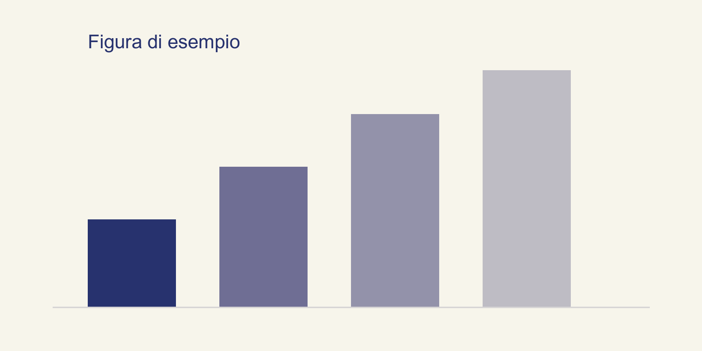

<!--
Corpo libero: struttura e titoli delle sezioni sono a scelta.
Gli elementi qui sotto mostrano la formattazione disponibile:
sostituiscili con il contenuto della settimana.
-->

# Titolo di sezione

Testo del paragrafo con **grassetto**, *corsivo*, `codice in linea`,
un [collegamento](https://www.unibs.it) e una nota a piè di pagina.[^nota]

## Sottosezione

- Elemento di un elenco puntato
- Secondo elemento
  - Elemento annidato

1. Primo passo
2. Secondo passo

### Terzo livello

| Attività          | Stato      | Ore |
|:------------------|:-----------|----:|
| Analisi           | completata |  12 |
| Sviluppo          | in corso   |  20 |

: Didascalia della tabella.

{width=70%}

> Citazione o osservazione da evidenziare.

```python
def esempio():
    return "blocco di codice"
```

[^nota]: Testo della nota.